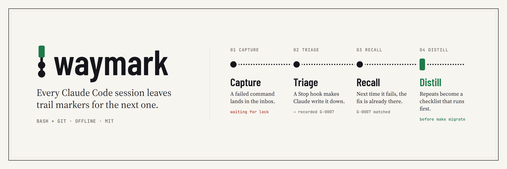
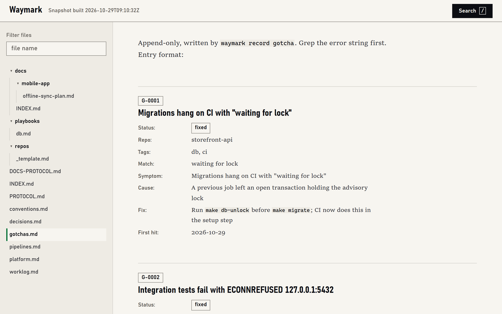
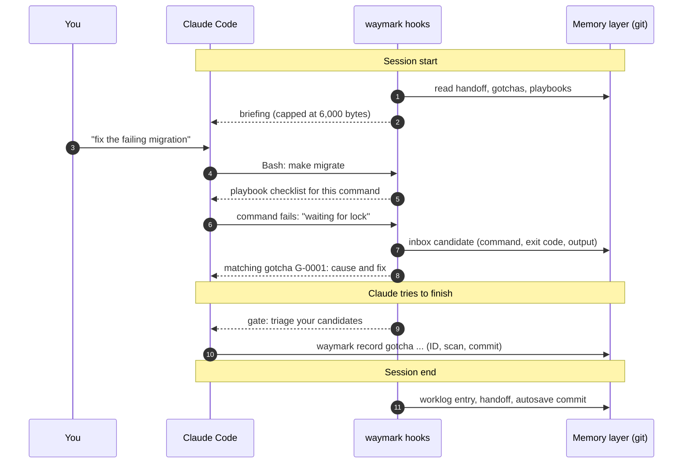
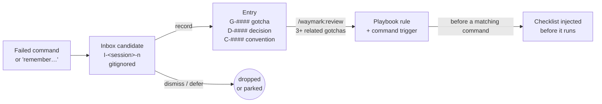
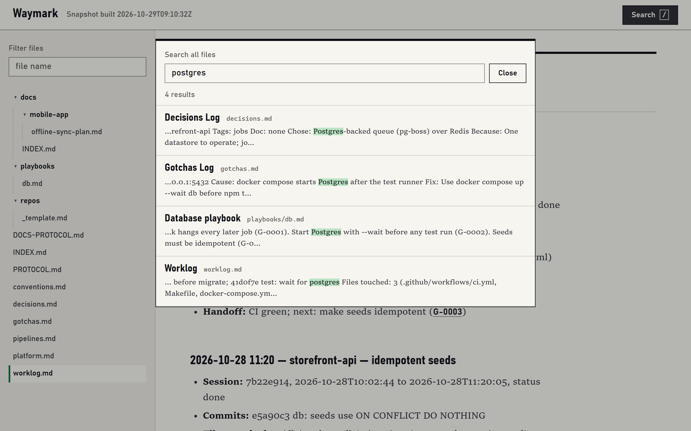
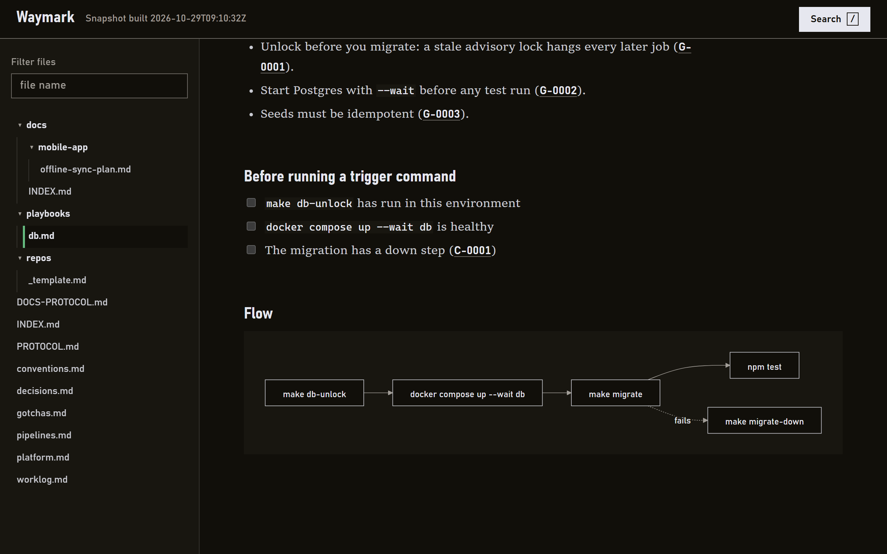
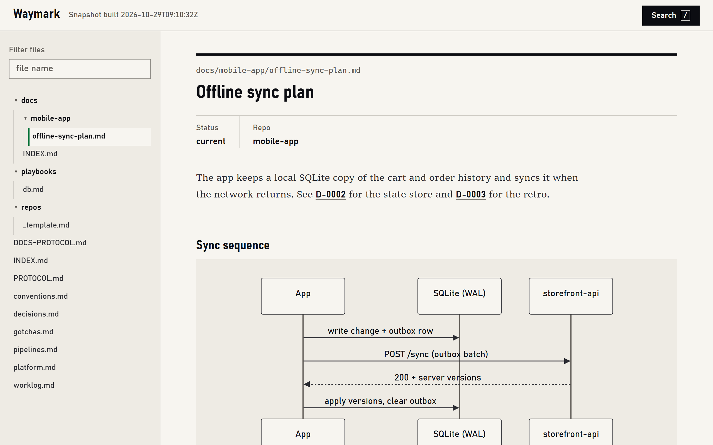
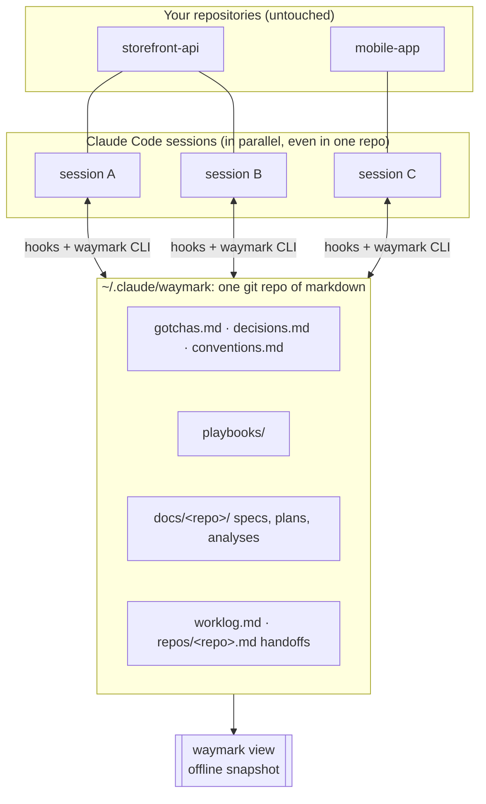

<p align="center">
  <picture>
    <source media="(prefers-color-scheme: dark)" srcset="docs/images/logo-dark.svg">
    
  </picture>
</p>

<h1 align="center">waymark</h1>

<p align="center">
  <strong>Persistent, git-native memory for Claude Code.</strong><br>
  Every session leaves trail markers for the next one: the gotchas you hit, the decisions you made, and where you stopped.
</p>

<p align="center">
  <a href="LICENSE"></a>
  
  
  
</p>

<p align="center">
  <a href="#install">Install</a> ·
  <a href="#how-it-works">How it works</a> ·
  <a href="#the-viewer">Viewer</a> ·
  <a href="#how-it-fits-your-workflow">Workflow</a> ·
  <a href="#faq">FAQ</a>
</p>

<p align="center">
  
</p>

---

## The problem

Claude Code starts every session cold. Yesterday it spent forty minutes discovering that your migrations hang because a CI job leaves an advisory lock behind. Today it hits the same error and starts from zero. The fix lived in a chat transcript that is gone.

Built-in auto-memory helps a little, but what gets remembered depends on the model deciding to write it down, the notes are hidden in a per-project folder, and nothing reviews them.

## What waymark does

Waymark turns that lost knowledge into a plain-markdown notebook in a git repository you own, and wires it into Claude Code with hooks so that capture and recall happen whether or not the model remembers to.

- **Captures mechanically.** A failed command becomes an inbox candidate automatically. Saying "remember…" creates one that must be handled before Claude replies.
- **Makes Claude triage.** Before Claude can finish, a gate asks it to record, dismiss or defer each new candidate. Nothing silently evaporates.
- **Recalls at the right moment.** When a command fails with output that matches a recorded gotcha, the cause and fix are injected immediately. Every session starts with a short briefing: the last handoff, the repo's known gotchas, and the playbook rules.
- **Distills over time.** `/waymark:review` turns clusters of gotchas into playbook rules with command triggers, so the checklist appears *before* the risky command runs.
- **Stays yours.** Plain markdown, in git, on your disk. Read it, diff it, blame it, revert it. A secrets scan runs on every commit, and nothing is ever sent anywhere.
- **Costs almost nothing.** Bash and git only: no Node, Python, Docker, database or vector store, and no extra model calls. The session-start briefing is capped at 6,000 bytes (about 1,500 tokens).

<p align="center">
  
</p>

## Install

In Claude Code:

```
/plugin marketplace add MohammedOmar3/waymark
/plugin install waymark@waymark
/waymark:setup
```

Setup asks for your name and email, where the memory layer should live (default `~/.claude/waymark`), whether waymark should replace Claude Code's built-in auto-memory, and optional `repo_roots` for stray-doc reports. It shows you the plan and waits for a yes. Then it creates the layer as a git repository, installs a pre-commit secrets scan, makes the first commit, and writes the pointer file `~/.claude/waymark.conf`. Start a fresh session afterwards.

Requirements: Claude Code, bash and git. Works on macOS, Linux and Windows (Git Bash).

<details>
<summary>Install from a local checkout</summary>

```
git clone https://github.com/MohammedOmar3/waymark.git
/plugin marketplace add /path/to/waymark
/plugin install waymark@waymark
```
</details>

## How it works

Waymark runs as eight Claude Code hooks around a loop of **capture, triage, recall and distill**.



Here is a real session-start briefing for a demo repository (trimmed):

```text
repo: storefront-api

Known gotchas (headings; grep the ID in gotchas.md for detail):
G-0003  Seed script duplicates rows on rerun
G-0002  Integration tests fail with ECONNREFUSED 127.0.0.1:5432
G-0001  Migrations hang on CI with "waiting for lock"
```

### The distillation ladder

Raw signal moves up the ladder only when someone decides it is worth keeping. Each step is plain markdown with a stable ID you can cite in commits and specs.



### What triggers what

| Moment | Hook | What waymark does |
|---|---|---|
| Session starts, resumes or compacts | `SessionStart` | Injects the briefing; creates the session's active file |
| You say "remember", "note that", "don't forget" | `UserPromptSubmit` | Creates a mandatory candidate Claude must handle first |
| Before a Bash command | `PreToolUse` | Injects the checklist of any playbook whose trigger matches |
| Before a write to auto-memory | `PreToolUse` | Blocks it and points Claude to waymark, when replacement is on |
| After a tool runs or fails | `PostToolUse` | Captures failures, recalls matching gotchas, tracks files touched |
| Claude tries to stop | `Stop` | Blocks until new candidates are triaged |
| Before compaction | `PreCompact` | Saves state so the next turn asks for a handoff |
| Session ends | `SessionEnd` | Writes the worklog entry and handoff, autosaves, rebuilds the viewer |

## The viewer

`waymark view` builds a single offline HTML snapshot of your whole layer and opens it in the browser. You get a file tree, full-text search, and mermaid diagrams, and IDs such as `G-0007` link to their entries. It follows your system's light or dark mode. No server, no install, no network: a Content-Security-Policy blocks every request. The snapshot rebuilds itself at the end of each session.

<table>
  <tr>
    <td width="50%"><br><sub>Search across every file</sub></td>
    <td width="50%"><br><sub>A playbook with its checklist and flow, in dark mode</sub></td>
  </tr>
  <tr>
    <td colspan="2"><br><sub>Specs and plans live next to the short facts, with diagrams rendered</sub></td>
  </tr>
</table>

## How it fits your workflow

Waymark doesn't ask you to change how you work. It sits underneath Claude Code and the skills you already use.



- **Specs and plans in one place.** Generated docs (for example from [superpowers](https://github.com/obra/superpowers) brainstorming and planning) go to `docs/<repo>/` in the layer, named and indexed. They don't litter your repositories. `waymark brief <terms>` pulls prior art and known pitfalls before a new spec is written.
- **Handoffs between sessions.** `/waymark:end-session` updates doc statuses, records a short retro and writes the handoff. The next session in that repo starts from it.
- **Parallel sessions.** Each session has its own inbox and active file. IDs are allocated under a lock, and other live sessions in the same repo are listed in the briefing.
- **Cite memory in commits.** When a memory informs a change, Claude cites its ID (`fix: unlock before migrate (G-0001)`), so `git log` links code back to the reason.

## Commands

Entries are only ever written through the CLI, so IDs and formats stay valid. IDs are `G-####` for gotchas, `D-####` for decisions and retros, `C-####` for conventions, and `I-<id8>-<n>` for inbox candidates.

| Command | Purpose |
|---|---|
| `waymark record gotcha\|decision\|retro\|convention [--from I-n] --field value ...` | Validate, allocate an ID under a lock, append, scan, commit |
| `waymark status G-0007 fixed\|obsolete` | Change an entry's status |
| `waymark inbox` / `dismiss I-n` / `defer I-n` | List and triage candidates |
| `waymark handoff "<text>"` | Write the handoff into the session's active file |
| `waymark brief <terms...>` | Prior-art brief across gotchas, decisions, conventions, playbooks and docs |
| `waymark scan` | Secrets scan of the layer |
| `waymark index` | Regenerate `docs/INDEX.md` |
| `waymark commit "<message>"` | Scan, then commit the layer |
| `waymark stats` | Capture score and recall-hit totals |
| `waymark strays` | Report stray docs in your repositories |
| `waymark view [--no-open]` | Build and open the snapshot viewer |

| Skill | Purpose |
|---|---|
| `/waymark:setup` | First-time setup |
| `/waymark:remember` | Record something explicitly |
| `/waymark:end-session` | Update doc statuses, record retros, write the handoff, commit |
| `/waymark:review` | Periodic upkeep and distillation |
| `/waymark:uninstall` | Guided undo |

## Waymark compared with built-in auto-memory

| | Built-in auto-memory | waymark |
|---|---|---|
| What gets saved | Whatever the model chooses to write | Every failed command and every "remember…" is captured. A gate makes Claude triage each one |
| When it is recalled | Loaded at session start | At session start, plus immediately when a failure matches a known gotcha, plus before a playbook's trigger command |
| Format | Free-form notes | Typed entries with stable IDs, playbooks, long-form docs |
| History | Files on disk | A git repository: diff, blame, revert, every commit secrets-scanned |
| Review | None | `/waymark:review` distills, flags obsolete entries and expired docs |
| Browsing | Open the folder | Offline viewer with search and diagrams |

## Privacy and safety

- The raw inbox (`inbox/`) is gitignored, so unreviewed command output never reaches git history.
- Every commit to the layer passes `waymark scan`, through the pre-commit hook and through `waymark commit`. It checks every text file git would commit for credential-like patterns. A failing autosave commits nothing and is reported at the next session start.
- Hooks never bypass verification or signing, never push, and never add a remote.
- No network access at runtime. The viewer's Content-Security-Policy blocks remote requests, including images linked in notes.
- Waymark never writes to your global `CLAUDE.md` or to any of your repositories.

## Limitations

- Repositories with the same directory name share one memory, because the repo name is the key.
- Search is grep only: `Match:` substrings and `waymark brief` terms. There is no semantic or vector search.
- Claude Code only.
- Capture of failures covers Bash commands. Judging what is worth keeping still relies on Claude. The gates enforce it at stop and compaction time but cannot make it perfect.

## FAQ

**Does waymark give Claude Code long-term memory across sessions and projects?**
Yes. The layer is one git repository shared by all your projects. Each repo gets its own handoff and tagged entries, and cross-repo knowledge lives in shared files and `docs/cross-repo/`.

**Does it send my code or notes anywhere?**
No. Waymark makes no network calls and adds no model calls. Everything stays in a local git repository. You decide whether that repository ever gets a remote.

**How much context does it use?**
The session-start briefing is capped at 6,000 bytes (about 1,500 tokens). Recall and checklist injections only appear when they match.

**Can I use it alongside CLAUDE.md?**
Yes. `CLAUDE.md` holds the rules you write by hand. Waymark holds what sessions learn. Waymark never edits `CLAUDE.md`.

**What happens if I uninstall?**
`/waymark:uninstall` restores any setting setup changed and removes the pointer file. The layer is deleted only if you explicitly confirm. Otherwise it stays an ordinary git repository of markdown you can keep reading.

## Uninstall

Run `/waymark:uninstall`. It confirms each step: it restores any setting setup changed, deletes `~/.claude/waymark.conf`, and points you to `/plugin uninstall waymark`. You can keep the layer, zip it first, or delete it on explicit confirmation.

## Contributing

Issues and pull requests are welcome. The test suite is plain bash: run `bash tests/run.sh` (or `bash tests/run.sh <name>` for one file). Hooks must stay compatible with bash 3.2 and POSIX tools, and must always exit 0.

## Credits

- The hook launcher pattern follows the [superpowers](https://github.com/obra/superpowers) plugin.
- The viewer bundles [marked](https://github.com/markedjs/marked), [DOMPurify](https://github.com/cure53/DOMPurify) and [mermaid](https://github.com/mermaid-js/mermaid). See `viewer/vendor/LICENSES.md`.

## License

MIT. See `LICENSE`.
